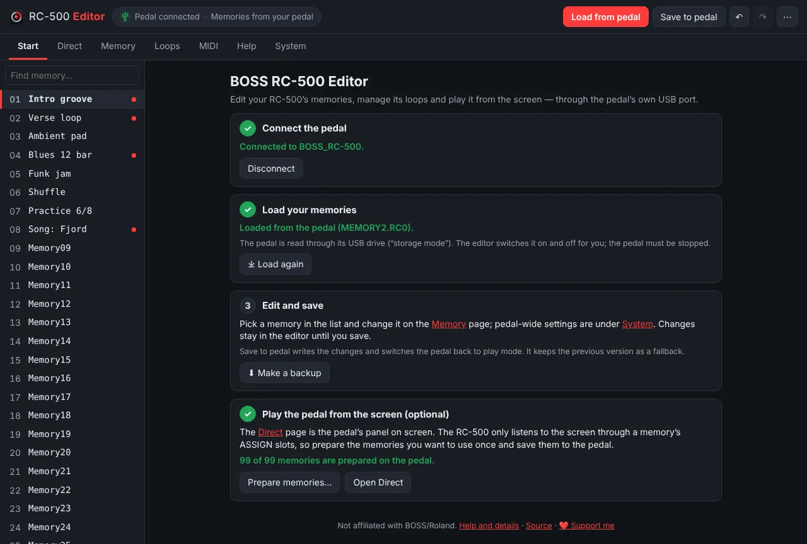
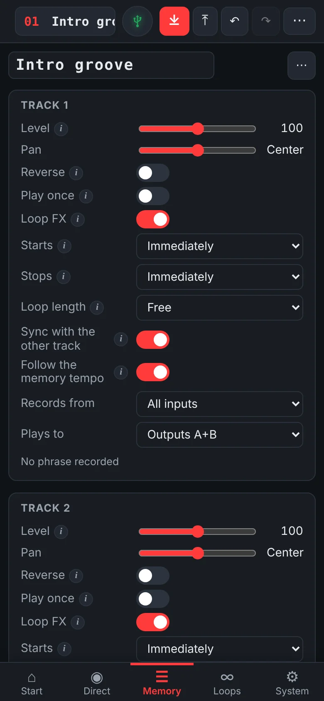

# BOSS RC-500 Editor (web + Android)

An editor for the **BOSS RC-500 Loop Station** that talks to the pedal through its own USB port —
no BOSS TONE STUDIO needed. Use it in the browser or as a standalone Android app.

> ⚠️ **Experimental – being tested on a real pedal.** Make a backup (⋯ › Back up the pedal’s data) before you
> save to the pedal. Not affiliated with BOSS/Roland.

**[Open the web version](https://jonsolberg.github.io/bossrc500editor/)** ·
**[Download the Android APK](https://github.com/jonsolberg/bossrc500editor/releases/latest/download/RC500Editor.apk)** ·
[all releases](https://github.com/jonsolberg/bossrc500editor/releases)

  

  
  
  
  
  

  
  
  

## Features

- **Start page** that walks you through connecting, loading, editing and saving, and shows where you are
- **Automatic**: connects over USB MIDI by itself, remembers the pedal's drive, switches storage mode on and off
  for *Load from pedal* / *Save to pedal*, checks what it wrote and warns if the pedal has newer changes
- **Plain names**: pedal functions and settings are described in plain words, with an ⓘ explanation next to
  most settings
- **Direct mode** (greyed out until an RC-500 is connected): play the pedal live from an on-screen copy of its panel — REC/PLAY, STOP and TRACK SELECT
  footswitches (hold REC/PLAY to undo, hold STOP for 2 s to clear), TRACK 1/2 level sliders with status lights, the colour
  display, rhythm ON/OFF, TEMPO (tap or type a tempo; sent as MIDI clock), LOOP FX and the MEMORY/VALUE knob. Keyboard shortcuts on a computer
  (Space, S, T, R, F, ↑/↓). The RC-500 only reacts to MIDI CC through a memory's ASSIGNs, so *Set up memories*
  adds the needed ASSIGNs (CC#80–89, see below) to the memories you choose; then save them to the pedal
- **All 99 memories**: name, both tracks (level, pan, reverse, 1-shot, loop FX, start/stop, measure, loop/tempo sync,
  input/output), record (dub mode, rec action, quantize, auto rec, loop length), play (tempo with tap, play mode,
  fade time, track chain …), Loop FX (type and beat-aware lengths), rhythm (pattern per time signature, kit,
  variation, start/stop, count-ins, fill, parts, tone), pedal/CTL/EXP functions and **ASSIGN 1–8** with target-aware
  min/max values
- **System settings**: display, undo/redo, preferences, system pedal functions, MIDI, extents, input/output
- ⋯ › Show stored values: a read-only view of every number stored for a memory and the system, for troubleshooting
- Copy a memory to a range (choose which parts), copy/paste, swap, initialize; undo/redo
- Presets: save a memory as a `.rc500.json` file and load it into any memory
- **Loops**: see which memories have recorded phrases, play them, export them as WAV, import any audio file
  (WAV/MP3/M4A … converted to the RC-500 format, 44.1 kHz 32-bit float stereo) or delete them
- **MIDI page**: switch memories (program change), start/stop, play the CC numbers used by the memory's
  ASSIGNs (button + value slider), MIDI monitor, follow the pedal's memory changes
- **Storage mode from the app**: the same SysEx that BOSS TONE STUDIO for RC sends turns the pedal's USB drive on/off,
  so you don't have to go through MENU › STORAGE on the pedal
- Backup of `ROLAND/DATA` as a ZIP; light/dark theme; works on a phone (bottom tabs, memory picker)

## How it works

The RC-500 has one USB port that carries both **USB MIDI** and, in storage mode, a **USB drive**
(`BOSS RC-500`) with `ROLAND/DATA/MEMORY1.RC0`, `MEMORY2.RC0`, `SYSTEM1.RC0`, `SYSTEM2.RC0` and the recorded
phrases in `ROLAND/WAVE/<memory>_<track>/`. The pedal keeps two copies of each data file and loads the one with
the higher save counter (the last 4 bytes). The editor reads the newest copy and saves to the *other* one with a
higher counter, so the previous version stays on the pedal as a fallback. Unchanged files are written back byte for
byte identical.

| | Read pedal | Write pedal | USB MIDI |
|---|---|---|---|
| Chrome / Edge / Opera (desktop, https) | ✅ | ✅ directly | ✅ |
| Firefox (https) | ✅ (pick the folder each time) | downloads the changed files to copy into `ROLAND/DATA` | ✅ (asks for permission) |
| Android app | ✅ | ✅ directly | ✅ |

Web MIDI and direct writing only work on secure (https) pages, so use the GitHub Pages link above.

### Direct mode CC numbers

| CC# | ASSIGN target | Panel control |
|---|---|---|
| 80 | CUR REC/PLY | REC/PLAY switch |
| 81 | CUR PLY/STP | STOP switch |
| 82 | TRK SELECT (0 = track 1, 127 = track 2) | TRACK SELECT switch, EDIT buttons |
| 83 / 84 | T1 / T2 LEVEL1 (0–200) | TRACK 1 / TRACK 2 sliders |
| 85 | RHYTHM P/S | Rhythm ON/OFF |
| 86 | CUR CLEAR | hold STOP |
| 87 | UNDO/REDO | hold REC/PLAY |
| 89 | LOOP FX (optional) | LOOP FX |

**Tempo** needs no ASSIGN: the editor sends MIDI clock over USB (set the tempo, or tap TEMPO). The pedal follows it
while it runs when SYSTEM › MIDI › Sync clock is AUTO (the default) or USB. No MIDI Start is sent, so the tracks
don't start by themselves.

Messages go out on the pedal's RX CTL channel (SYSTEM › MIDI). Memories are selected with program change, and
MIDI Start/Stop start and stop everything. The pedal reports which tracks have a phrase and when playback starts
and stops; the rest of the lights follow your presses. The on-screen track sliders set the level on the pedal,
but they can't follow the pedal's own sliders: the RC-500 doesn't send those over USB.

### Using it

1. Power the RC-500 (adapter or batteries, with a cable in OUTPUT A/MONO – that jack is its power switch) and
   connect it with a USB cable that carries data (on a phone: USB-C/OTG).
2. Open the editor. It connects over USB MIDI by itself (the first time, allow MIDI/SysEx in the browser).
3. **⤓ Load from pedal** – the editor puts the pedal in storage mode and reads its memories. The first time you
   pick the `BOSS RC-500` drive (or its `ROLAND` folder); after that it's remembered (not in Firefox). If storage
   mode doesn't start, use MENU › STORAGE › CONNECTING on the pedal. The pedal must be stopped.
4. Edit, then **⤒ Save to pedal**. The files are written and checked, and the pedal leaves storage mode and reloads
   its memories. (In Firefox, copy the downloaded files into `ROLAND/DATA`, eject the drive and leave storage
   mode on the pedal.)
5. For Direct mode: **Set up memories…** on the Start or Direct page, then save to the pedal.

### Tested so far

On a real RC-500: USB MIDI in both directions (program change, start/stop, the pedal's status messages), reading
the memories and loops, playing and exporting a loop, backup, writing memory changes (name and tempo checked on the
pedal) and saving Direct mode ASSIGNs. Still being tested: playing the pedal from Direct mode and storage mode
started from the editor in every browser.

## Building

- **Web**: plain HTML/CSS/JS in [`web/`](web), no build step. Open `web/index.html` or serve the folder.
  The `pages` workflow publishes it to GitHub Pages.
- **Android**: the app bundles `web/` as its assets and adds a native bridge (`MainActivity.java`) for USB MIDI
  (`android.media.midi`) and the USB drive (Storage Access Framework). Push to GitHub — the `build` workflow
  builds a signed APK and publishes it as a release. Or open the folder in Android Studio.

## Credits

The RC-500 file format, the value encoding and the storage-mode SysEx were worked out by D. Fleury in
[boss-rc500-editor](https://github.com/dfleury2/boss-rc500-editor) (MIT licence, © 2022 D. Fleury), which this
project started from. Parameter descriptions follow the BOSS RC-500 Parameter Guide.

## Support

The editor is free, open source and has no ads. If you find it useful, you can
[support me on Ko-fi](https://ko-fi.com/jonsolberg) ❤️

## License

Copyright © 2026 Jon Solberg

This program is free software: you can redistribute it and/or modify it under the terms of the
GNU General Public License as published by the Free Software Foundation, either version 3 of the
License, or (at your option) any later version.

This program is distributed in the hope that it will be useful, but WITHOUT ANY WARRANTY; without
even the implied warranty of MERCHANTABILITY or FITNESS FOR A PARTICULAR PURPOSE. See the
[GNU General Public License](LICENSE) for more details.
