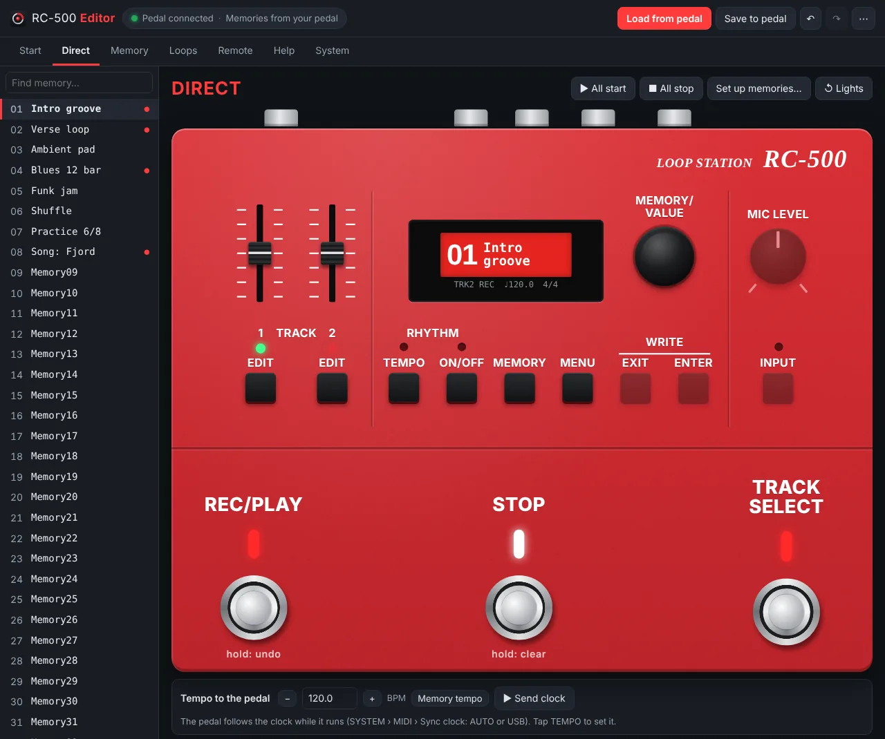
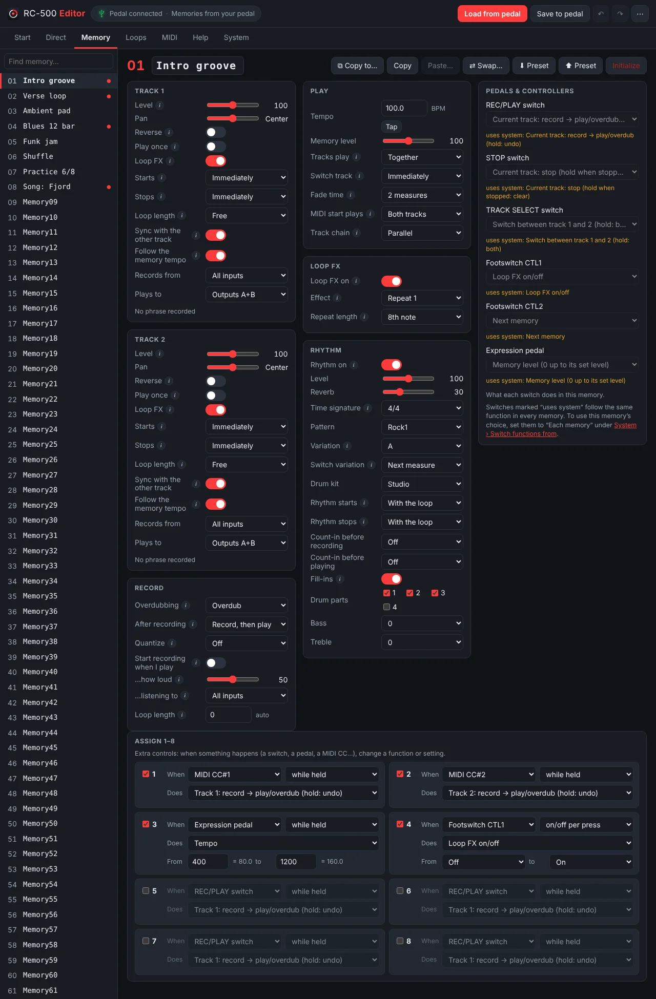
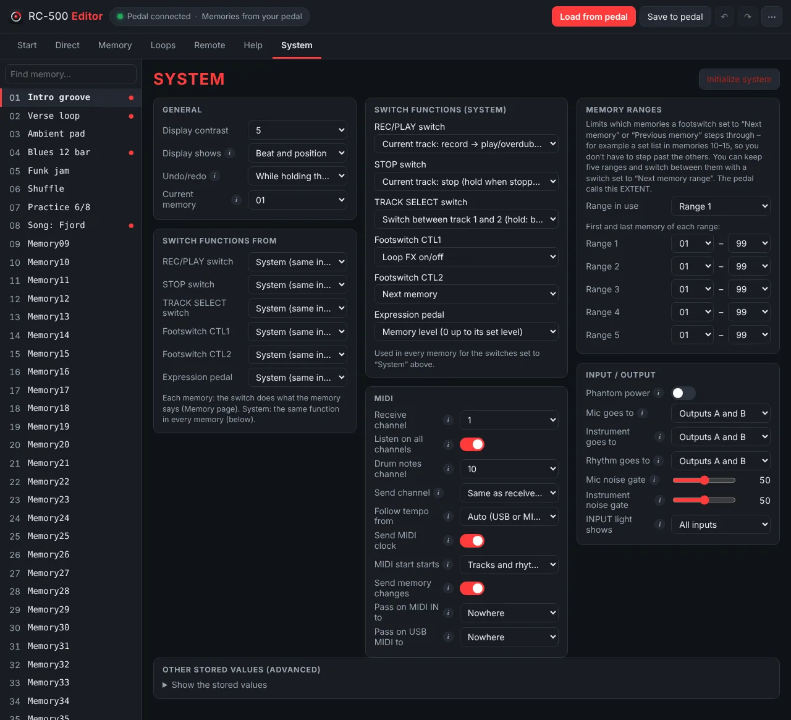
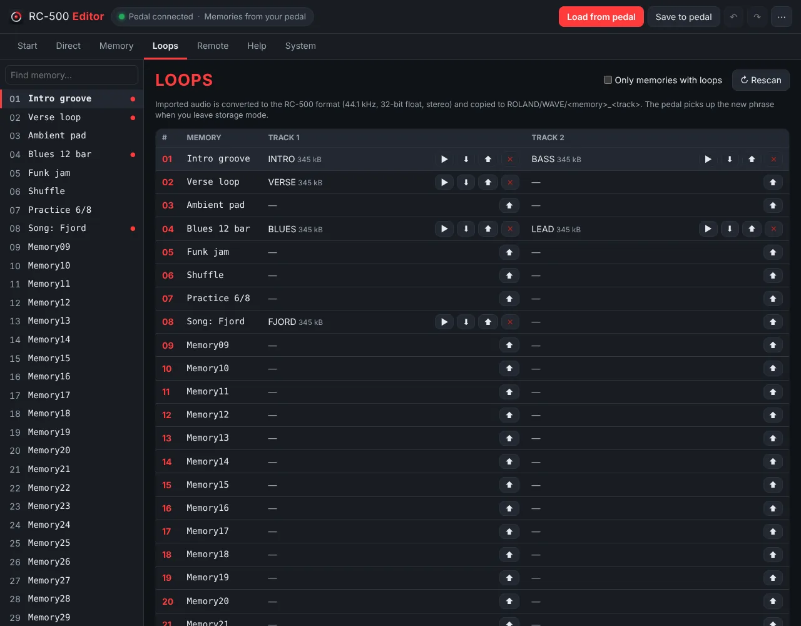
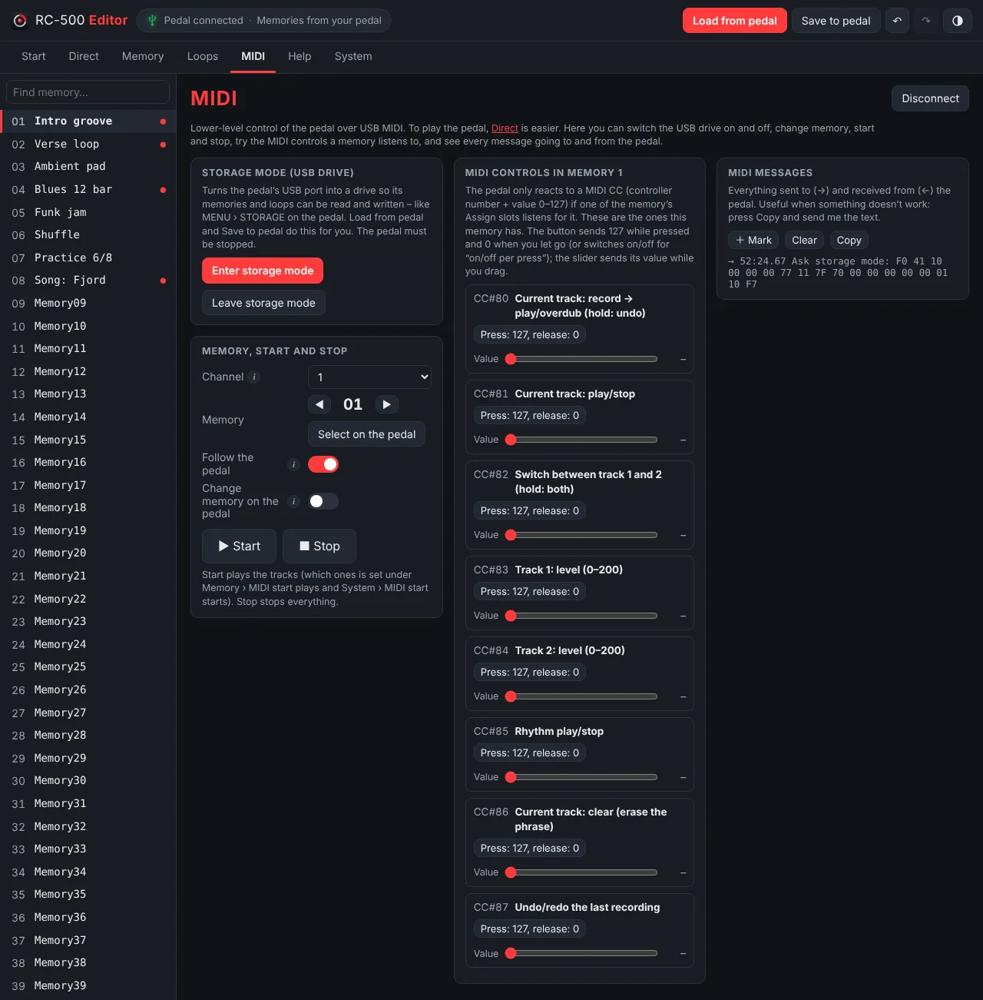
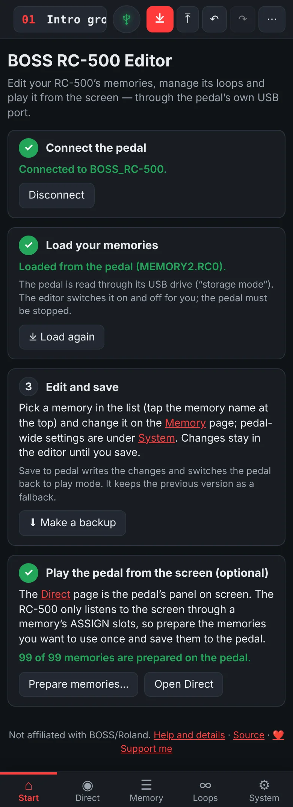
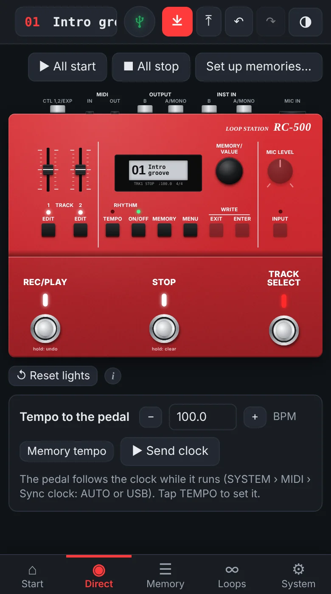

# RC-500 Editor (web + Android)

An editor for the **BOSS RC-500 Loop Station** that talks to the pedal through its own USB port.
Use it in the browser or as a standalone Android app.

> **Recommended: Chrome or Edge** (or another Chromium-based browser such as Opera) on a computer, or the Android app on a
> phone – they work directly with the pedal. Make a backup (System › Pedal data) the first time you save to the
> pedal. Not affiliated with BOSS/Roland.

**[Open the web version](https://jonsolberg.github.io/rc500editor/)** ·
**[Download the Android APK](https://github.com/jonsolberg/rc500editor/releases/latest/download/RC500Editor.apk)** ·
[all releases](https://github.com/jonsolberg/rc500editor/releases)

  

  
  
  
  
  

  
  
  

## Features

- **Start page** that walks you through connecting, loading, editing and saving, and shows where you are
- **Automatic**: connects over USB MIDI by itself, remembers the pedal's drive, switches storage mode on and off
  for *Load from pedal* / *Save to pedal*, checks what it wrote and warns if the pedal has newer changes
- **Plain names**: pedal functions and settings are described in plain words, with an ⓘ explanation next to
  most settings
- **Direct mode** (greyed out until an RC-500 is connected): play the pedal live from an on-screen copy of its panel — REC/PLAY, STOP and TRACK SELECT
  footswitches (hold REC/PLAY to undo, hold STOP for 2 s to clear), TRACK 1/2 level sliders with status lights, the colour
  display, rhythm ON/OFF, TEMPO (tap or type a tempo; sent as MIDI clock), LOOP FX and the MEMORY/VALUE knob. Keyboard shortcuts on a computer
  (Space, S, T, R, F, ↑/↓). The RC-500 only reacts to MIDI CC through a memory's ASSIGNs, so *Set up memories*
  adds the needed ASSIGNs (CC#80–89, see below) to the memories you choose; then save them to the pedal
- **All 99 memories**: name, both tracks (level, pan, reverse, 1-shot, loop FX, start/stop, measure, loop/tempo sync,
  input/output), record (dub mode, rec action, quantize, auto rec, loop length), play (tempo with tap, play mode,
  fade time, track chain …), Loop FX (type and beat-aware lengths), rhythm (pattern per time signature, kit,
  variation, start/stop, count-ins, fill, parts, tone), pedal/CTL/EXP functions and **ASSIGN 1–8** with target-aware
  min/max values
- **System settings**: display, undo/redo, preferences, system pedal functions, MIDI, extents, input/output
- System › Pedal data › Show stored values: a read-only view of every number stored for a memory and the system, for troubleshooting
- Copy a memory to a range (choose which parts), copy/paste, swap, initialize; undo/redo
- Presets: save a memory as a `.rc500.json` file and load it into any memory
- **Loops**: see which memories have recorded phrases, play them, export them as WAV, import any audio file
  (WAV/MP3/M4A … converted to the RC-500 format, 44.1 kHz 32-bit float stereo) or delete them. In bulk:
  **Export all** saves every loop to a folder (named by memory and track), **Import a set** puts a folder of audio
  files into the free tracks (naming the memories and setting the tempo from "BPM…" in the file names), and
  **Delete all** clears the pedal
- **MIDI page**: switch memories (program change), start/stop, play the CC numbers used by the memory's
  ASSIGNs (button + value slider), MIDI monitor, follow the pedal's memory changes
- **Storage mode from the app**: a SysEx message turns the pedal's USB drive on/off,
  so you don't have to go through MENU › STORAGE on the pedal
- Backup of `ROLAND/DATA` as a ZIP; light/dark theme; works on a phone (bottom tabs, memory picker)

## How it works

The RC-500 has one USB port that carries both **USB MIDI** and, in storage mode, a **USB drive**
(`BOSS RC-500`) with `ROLAND/DATA/MEMORY1.RC0`, `MEMORY2.RC0`, `SYSTEM1.RC0`, `SYSTEM2.RC0` and the recorded
phrases in `ROLAND/WAVE/<memory>_<track>/`. The pedal keeps two copies of each data file and loads the one with
the higher save counter (the last 4 bytes). The editor reads the newest copy and saves to the *other* one with a
higher counter, so the previous version stays on the pedal as a fallback. Unchanged files are written back byte for
byte identical.

### Which browser to use

The editor needs two things from the browser: access to the pedal's **USB drive** (to load and save memories and
loops) and **USB MIDI** (to connect, switch storage mode on and off by itself, and for Direct mode and the MIDI page).
Browsers differ in how much of that they allow:

| | Load from the pedal | Save to the pedal | USB MIDI (connect, Direct, MIDI page) |
|---|---|---|---|
| **Chrome, Edge or Opera** on a computer | ✅ remembers the drive | ✅ writes the files straight to the pedal | ✅ |
| **Firefox** on a computer | ✅ but you pick the drive each time | ⚠️ downloads the changed files – you copy them into `ROLAND/DATA` on the drive yourself | ✅ asks for permission the first time |
| **Android app** | ✅ remembers the drive | ✅ writes the files straight to the pedal | ✅ |
| Safari, iPhone/iPad | ❌ | ❌ | ❌ no Web MIDI |

In short: on a computer, Chrome or Edge does everything; on a phone, use the Android app. Firefox works, but saving
needs the extra copy step.

Use the web version from the link at the top: USB MIDI and writing to the drive only work on secure (https) pages, so
a copy opened from your own disk can't do them.

### How Direct mode talks to the pedal

The RC-500 doesn't let a computer press its buttons directly. What it does have is eight **Assign** slots in every
memory: each one can listen for a MIDI control message (a "CC" – a number plus a value 0–127) and do something
when it arrives. *Set up memories…* in the editor fills free Assign slots with the controls below. When you press
a switch on screen, the editor sends its CC number; the memory's Assign makes the pedal do the same thing as the
real switch. That's why a memory has to be set up – and saved to the pedal – before Direct mode can play it.

You only need this table if you want to set up the Assigns by hand, or control the pedal from another MIDI device
in the same way:

| CC# | What the pedal does (Assign target) | Control on screen |
|---|---|---|
| 80 | Current track: record → play/overdub (CUR REC/PLY) | REC/PLAY switch |
| 81 | Current track: play/stop (CUR PLY/STP) | STOP switch |
| 82 | Select track 1 or 2 (TRK SELECT; 0 = track 1, 127 = track 2) | TRACK SELECT switch, EDIT buttons |
| 83 / 84 | Track 1 / track 2 level (T1 / T2 LEVEL1, 0–200) | TRACK 1 / TRACK 2 sliders |
| 85 | Rhythm play/stop (RHYTHM P/S) | Rhythm ON/OFF |
| 86 | Current track: clear (CUR CLEAR) | hold STOP |
| 87 | Undo/redo (UNDO/REDO) | hold REC/PLAY |
| 89 | Loop FX on/off (LOOP FX, optional) | LOOP FX |

**Tempo** needs no ASSIGN: the editor sends MIDI clock over USB (set the tempo, or tap TEMPO). The pedal follows it
while it runs when SYSTEM › MIDI › Sync clock is AUTO (the default) or USB. No MIDI Start is sent, so the tracks
don't start by themselves.

Messages go out on the pedal's RX CTL channel (SYSTEM › MIDI). Memories are selected with program change, and
MIDI Start/Stop start and stop everything. The pedal reports which tracks have a phrase and when playback starts
and stops; the rest of the lights follow your presses. The on-screen track sliders set the level on the pedal,
but they can't follow the pedal's own sliders: the RC-500 doesn't send those over USB.

### Using it

1. Power the RC-500 (adapter or batteries, with a cable in OUTPUT A/MONO – that jack is its power switch) and
   connect it with a USB cable that carries data (on a phone: USB-C/OTG).
2. Open the editor. It connects over USB MIDI by itself (the first time, allow MIDI/SysEx in the browser).
3. **⤓ Load from pedal** – the editor puts the pedal in storage mode and reads its memories. The first time you
   pick the `BOSS RC-500` drive (or its `ROLAND` folder); after that it's remembered (not in Firefox). If storage
   mode doesn't start, use MENU › STORAGE › CONNECTING on the pedal. The pedal must be stopped.
4. Edit, then **⤒ Save to pedal**. The files are written and checked, and the pedal leaves storage mode and reloads
   its memories. (In Firefox, copy the downloaded files into `ROLAND/DATA`, eject the drive and leave storage
   mode on the pedal.)
5. For Direct mode: **Set up memories…** on the Start or Direct page, then save to the pedal.

### Tested so far

On a real RC-500, in Chrome on Windows: USB MIDI in both directions (program change, start/stop, the pedal's status
messages), switching storage mode on and off from the editor, reading the memories automatically on connect, backup,
writing memory changes, saving Direct mode ASSIGNs, playing the pedal from Direct mode, and the Loops tab (reading,
playing, exporting, importing and deleting loops – an imported loop plays on the pedal). Other browsers and the
Android app have had less testing; please report problems as issues.

### Android: if the drive doesn't appear

Android only mounts the pedal's drive when the pedal is already in storage mode as the USB cable is connected. If the
folder picker doesn't list it: unplug the cable, choose MENU › STORAGE › CONNECTING on the pedal (it shows
PREPARING…), then plug the cable back in.

## Building

- **Web**: plain HTML/CSS/JS in [`web/`](web), no build step. Open `web/index.html` or serve the folder.
  The `pages` workflow publishes it to GitHub Pages.
- **Android**: the app bundles `web/` as its assets and adds a native bridge (`MainActivity.java`) for USB MIDI
  (`android.media.midi`) and the USB drive (Storage Access Framework). Push to GitHub — the `build` workflow
  builds a signed APK and publishes it as a release. Or open the folder in Android Studio.

## Credits

The RC-500 file format, the value encoding and the storage-mode SysEx were worked out by D. Fleury in
[boss-rc500-editor](https://github.com/dfleury2/boss-rc500-editor) (MIT licence, © 2022 D. Fleury), which this
project started from. Parameter descriptions follow the BOSS RC-500 Parameter Guide.

## Support

The editor is free, open source and has no ads. If you find it useful, you can
[support me on Ko-fi](https://ko-fi.com/jonsolberg) ❤️

## License

Copyright © 2026 Jon Solberg

This program is free software: you can redistribute it and/or modify it under the terms of the
GNU General Public License as published by the Free Software Foundation, either version 3 of the
License, or (at your option) any later version.

This program is distributed in the hope that it will be useful, but WITHOUT ANY WARRANTY; without
even the implied warranty of MERCHANTABILITY or FITNESS FOR A PARTICULAR PURPOSE. See the
[GNU General Public License](LICENSE) for more details.
